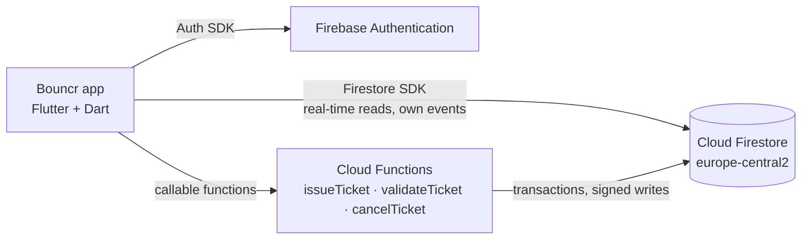

# Bouncr 🕶️

**The digital bouncer for student events.** Secure QR tickets, with no fake tickets and no double entry.

> Student clubs run their events with Google Forms and screenshot "tickets", so tickets get copied and shared, events get overbooked, and organisers have no reliable way to check who is allowed in.

Bouncr lets any student publish an event with a limited number of seats. Attendees get a **server-signed QR ticket**, and the organiser scans it at the door: a valid ticket is accepted **once**, while a copied, reused or forged one is rejected.

Built with **Flutter** and **Firebase (Google Cloud)** for the course *Project – Mobile Application in the Cloud* at Akademia WSB.

---

## Team

| Role | Member |
|---|---|
| Product Owner | Emad Abouelsaad |
| Tech Lead | Emad Abouelsaad |
| Developer | Emad Abouelsaad |
| QA / DevOps | Emad Abouelsaad |

Individual project, approved by the instructor. Flutter is used instead of Kotlin/Compose, also with the instructor's approval.

## MVP features

| # | Feature | Sprint |
|---|---|---|
| 1 | **Account**: register, log in, log out, auto-login | Sprint 1 (Lab 1) |
| 2 | **Browse events**: live list of upcoming events with seats left | Sprint 1 (Lab 2) |
| 3 | **Create & edit my event**: owner only, enforced by Security Rules | Sprint 1 (Lab 2) |
| 4 | **Get a ticket**: RSVP. A Cloud Function issues an HMAC-signed QR ticket, no overbooking | Lab 3 |
| 5 | **Check-in at the door**: organiser scans the QR, valid once, reuse or forgery rejected | Lab 3 |
| 6 | **Cancel my ticket**: frees the seat | Later |

## Data model (Cloud Firestore)

| Collection | Fields (type) | Owner link |
|---|---|---|
| `users` | **uid** (doc id) · email (string) · displayName (string) · createdAt (timestamp) | doc id = uid |
| `events` | ownerId (string) · title (string) · description (string) · location (string) · startsAt (timestamp) · capacity (number) · ticketsIssued (number, server-only) | `ownerId` |
| `tickets` | doc id = `{eventId}_{uid}` · ownerId (string) · eventId (string) · eventTitle (string) · status (`valid` / `used` / `cancelled`) · signature (string) · usedAt (timestamp, nullable) | `ownerId` |

## Architecture



The app is split into three layers:

| Layer | Folder | Responsibility |
|---|---|---|
| Data | `lib/data` | Repositories, the only code that talks to Firebase |
| Domain | `lib/domain` | Models, pure-Dart validators and error messages (unit-tested) |
| UI | `lib/ui` | Screens and ViewModels (`ChangeNotifier`). Navigation reacts to the auth state |

## Tech stack

Flutter 3 · Dart 3 · Firebase Authentication · Cloud Firestore · Cloud Functions (TypeScript, Node 22) · go_router · provider · GitHub Projects

## How to run

**Requirements:** Flutter SDK (stable), Android SDK with an emulator (API 26+, Google Play image) or a phone with USB debugging.

```bash
git clone https://github.com/Emad-Student/bouncr.git
cd bouncr
flutter pub get
flutter run
```

The Firebase configuration (`lib/firebase_options.dart`, `android/app/google-services.json`) is committed: it identifies the Firebase project and is not a secret. Data is protected by Firestore Security Rules.

### Tests

```bash
flutter test
```

## Workflow

- `main` is protected by a ruleset: pull request required, no force pushes, no deletion.
- Work happens on feature branches (`feature/auth`, …) with small [conventional commits](https://www.conventionalcommits.org/), and each one is squash-merged after review.
- Planning lives on the [Sprint board](https://github.com/users/Emad-Student/projects/1) with user stories and acceptance criteria.
