<p align="center">
  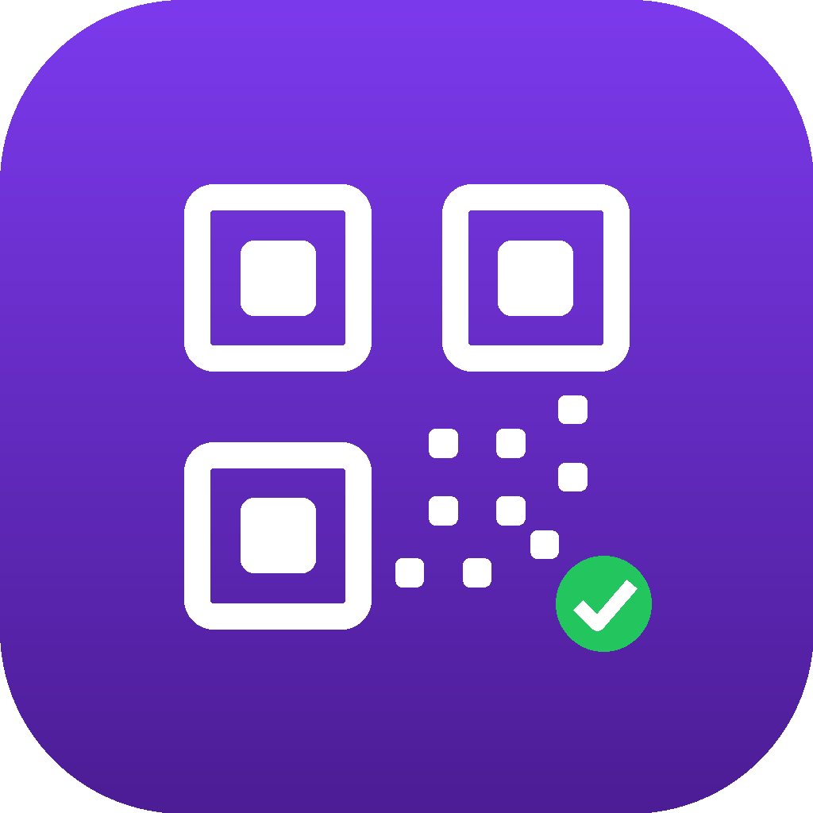
</p>

<h1 align="center">Bouncr</h1>

<p align="center">
  <b>The digital bouncer for student events.</b><br>
  Server-signed QR tickets: no fake tickets, no double entry, no overbooking.
</p>

<p align="center">
  <a href="https://github.com/Emad-Student/bouncr/actions/workflows/ci.yml"></a>
  
  
  
  
</p>

---

> **Problem.** Student clubs run their events with Google Forms and screenshot "tickets", so tickets get copied and shared, events get overbooked, and organisers have no reliable way to check who is allowed in.

**Bouncr** lets any student publish an event with a limited number of seats. Attendees get a **QR ticket issued and signed by the server**, and the organiser scans it at the door. A valid ticket is accepted **exactly once**, while a copied, reused or forged one is rejected.

Built with **Flutter** and **Firebase (Google Cloud)** for the course *Project – Mobile Application in the Cloud* at Akademia WSB.

## Screenshots

| Sign in | Live events | Signed QR ticket | My tickets |
|:---:|:---:|:---:|:---:|
| 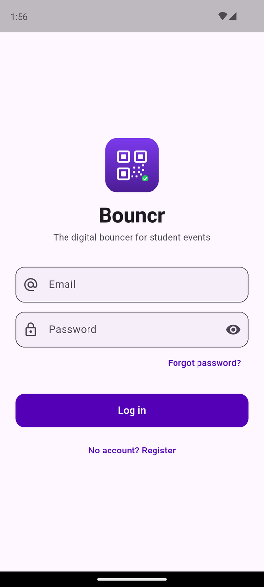 | 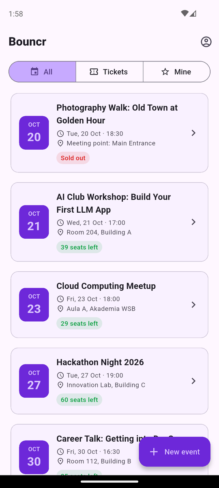 | 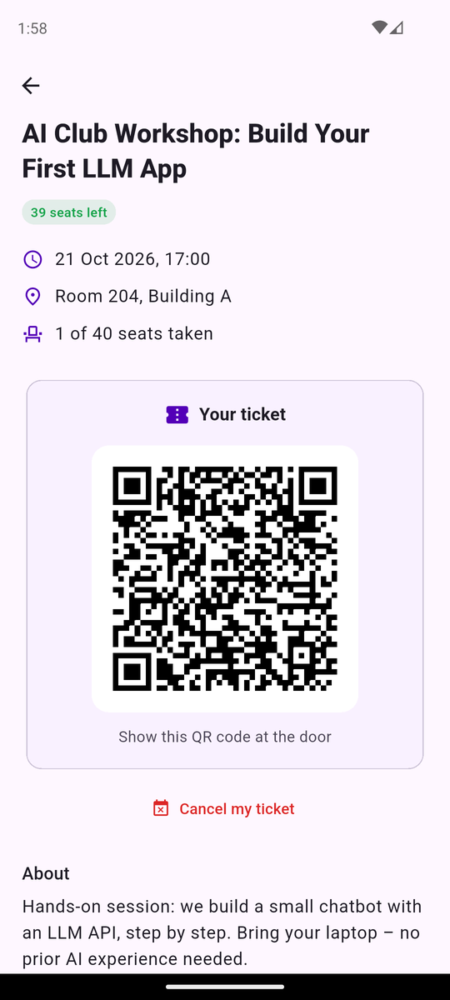 | 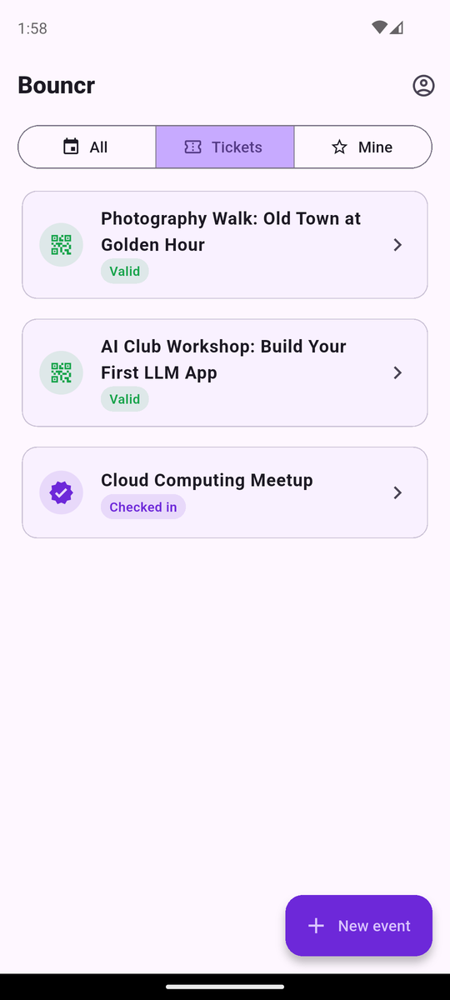 |

| Organiser view | Create event | Door check-in ✅ | Second scan ❌ |
|:---:|:---:|:---:|:---:|
| 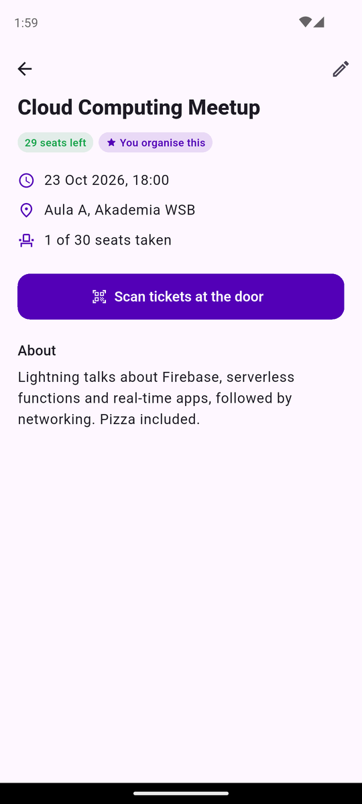 | 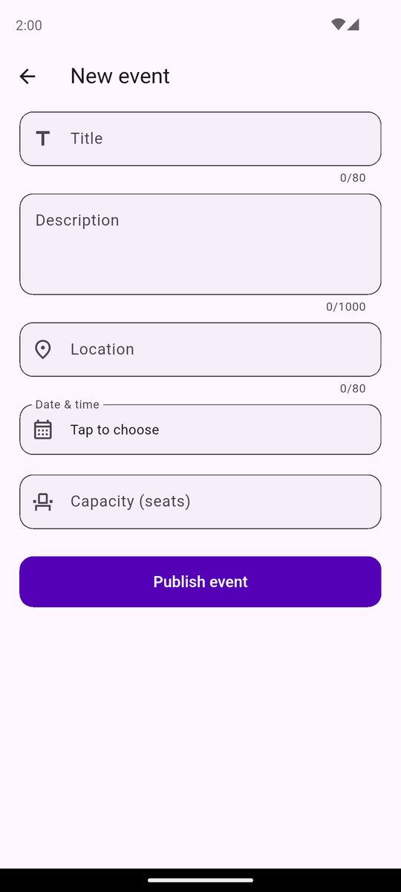 | 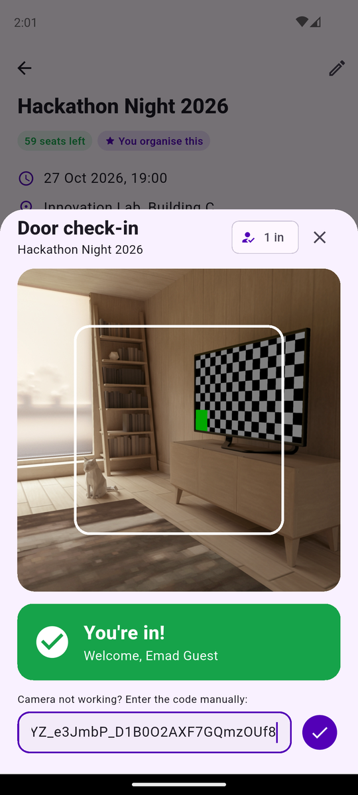 | 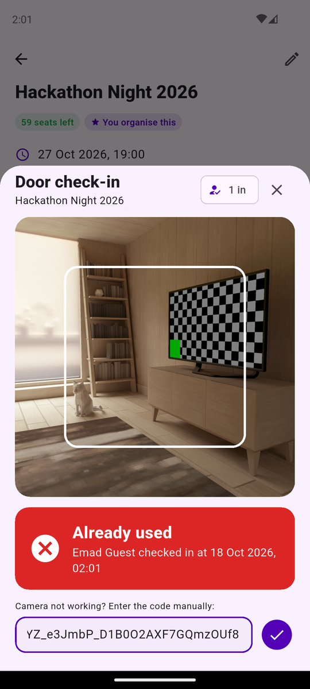 |

## Features

| # | Feature | Delivered |
|---|---|---|
| 1 | **Account**: register, log in, log out, auto-login, password reset | Lab 1 · #9, #15 |
| 2 | **Browse events**: real-time list with seats left, *All / Tickets / Mine* filters, offline-first saving | Lab 2 · #10, #12 |
| 3 | **Create & edit my event**: owner only, enforced by Security Rules | Lab 2 · #10 |
| 4 | **Get a ticket**: a Cloud Function issues an HMAC-signed QR ticket with optimistic concurrency control, so seats can never be overbooked | Lab 3 · #13, #20 |
| 5 | **Check-in at the door**: camera scanner (with manual fallback). Valid once; reuse, forgery and wrong-event tickets are rejected | Lab 3 · #13 |
| 6 | **Cancel my ticket**: the seat is freed for someone else | Lab 3 · #13 |

## How a ticket stays secure

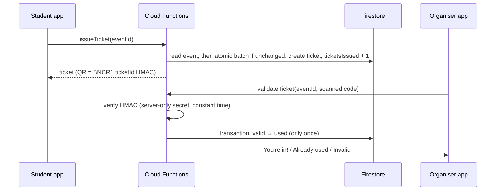

| Threat | Defence |
|---|---|
| **Forged QR** | The signature is HMAC-SHA256 with a key that exists only on the server. A code built by anyone else fails verification. |
| **Overbooking** under simultaneous RSVPs | Optimistic concurrency control: the ticket and the seat counter are written in one atomic batch that only commits if the event is unchanged since it was read (`lastUpdateTime` precondition). A lost race fails fast and retries with backoff and jitter, with no locks and no deadlocks. Tested: **20 parallel RSVPs for 5 seats → exactly 5 tickets** in CI, 40 → 5 locally. |
| **Screenshot shown twice** | `valid → used` happens once, in a transaction. The second scan returns *Already used* with the check-in time. |
| **Tampering from the app** | Security Rules: users edit only their own events, cannot change `ownerId` or the seat counter, and can never write tickets. 21 rules tests prove it. |
| **Duplicate tickets** | The ticket id is `{eventId}_{uid}`, so a repeated RSVP returns the same ticket (idempotent). |

## Architecture

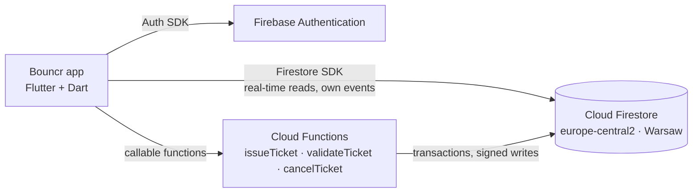

| Layer | Folder | Responsibility |
|---|---|---|
| Data | `lib/data` | Repositories, the only code that talks to Firebase |
| Domain | `lib/domain` | Models, pure-Dart validators and error messages (unit-tested) |
| UI | `lib/ui` | Screens and ViewModels (`ChangeNotifier`). Navigation (`go_router`) reacts to the auth state |
| Backend | `functions/src` | Callable Cloud Functions (TypeScript). Ticket-code crypto lives in a pure, unit-tested module |

### Data model (Cloud Firestore)

| Collection | Fields (type) | Owner link |
|---|---|---|
| `users` | **uid** (doc id) · email (string) · displayName (string) · createdAt (timestamp) | doc id = uid |
| `events` | ownerId (string) · title (string) · description (string) · location (string) · startsAt (timestamp) · capacity (number) · ticketsIssued (number, server-only) | `ownerId` |
| `tickets` | doc id = `{eventId}_{uid}` · ownerId (string) · eventId (string) · eventTitle (string) · status (`valid` / `used` / `cancelled`) · signature (string) · usedAt (timestamp, nullable) | `ownerId` |

## Quality

| Suite | Count | Runs in |
|---|---|---|
| Flutter unit + widget tests (validators, view models, auth / events / tickets flows) | 38 | `flutter test` |
| Firestore Security Rules tests (what a client bypassing the app can and cannot do) | 21 | Firestore emulator |
| Ticket-code and retry unit tests (signing, forgery, malformed codes, conflict retry) | 10 | Node test runner |
| End-to-end Cloud Functions tests (overbooking, idempotency, check-in, cancel) | 5 | Auth + Firestore + Functions emulators |

All suites run on every pull request in **GitHub Actions** ([`ci.yml`](.github/workflows/ci.yml)), and `flutter analyze` reports no issues.

## How to run

**Requirements:** Flutter SDK (stable), Android SDK with an emulator (API 26+, Google Play image) or a phone with USB debugging, Node.js 22+, Firebase CLI, Java 11+ (for the emulators).

```bash
git clone https://github.com/Emad-Student/bouncr.git
cd bouncr
flutter pub get
```

### 1. Start the ticket backend (Cloud Functions)

Deploying Cloud Functions requires the paid Blaze plan, so on the free Spark plan they run in the **Firebase Emulator** on your machine. Authentication and Firestore stay in the real cloud project, which is why users, events and tickets show up in the Firebase Console.

```bash
cd functions
npm install
npm run build        # also creates functions/.secret.local with a random signing key on first run
cd ..
firebase emulators:start --only functions
```

### 2. Run the app

The app reaches the Functions emulator through `adb reverse`, which works the same for the Android emulator and for a phone connected by USB:

```bash
adb reverse tcp:5001 tcp:5001        # once per device (add -s <serial> for several)
flutter run --dart-define=FUNCTIONS_EMULATOR_HOST=127.0.0.1
```

Demo accounts (password `secret123`): **emad.organiser@bouncr-demo.com** organises the demo events, and **emad.guest@bouncr-demo.com** holds tickets.

The Firebase configuration (`lib/firebase_options.dart`, `android/app/google-services.json`) is committed: it identifies the Firebase project and is not a secret. Data is protected by Firestore Security Rules, and the ticket signing key lives only in `functions/.secret.local` (git-ignored) or Secret Manager.

### Tests

```bash
flutter analyze && flutter test
cd firestore-tests && npm install && npm run test:emulator && cd ..
cd functions && npm test && npm run test:integration
```

## Tech stack

Flutter 3 · Dart 3 · Firebase Authentication · Cloud Firestore · Cloud Functions (TypeScript, Node 22) · Firebase Emulator Suite · go_router · provider · qr_flutter · mobile_scanner · GitHub Actions · GitHub Projects

## Team

| Role | Member |
|---|---|
| Product Owner · Tech Lead · Developer · QA / DevOps | Emad Abouelsaad |

Individual project, approved by the instructor. Flutter is used instead of Kotlin/Compose, also with the instructor's approval.

## Workflow

- `main` is protected by a ruleset: pull request required, no force pushes, no deletion.
- Feature branches with small [conventional commits](https://www.conventionalcommits.org/). Every PR is reviewed, passes CI and is squash-merged.
- Planning lives on the [Sprint board](https://github.com/users/Emad-Student/projects/1): user stories with acceptance criteria, plus bugs found during testing (#11, #14).
